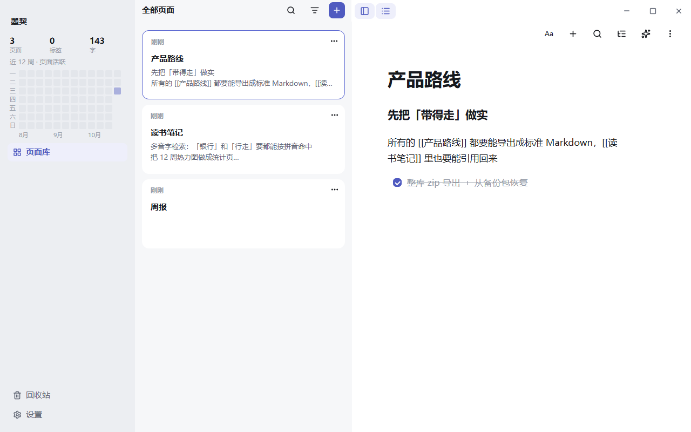
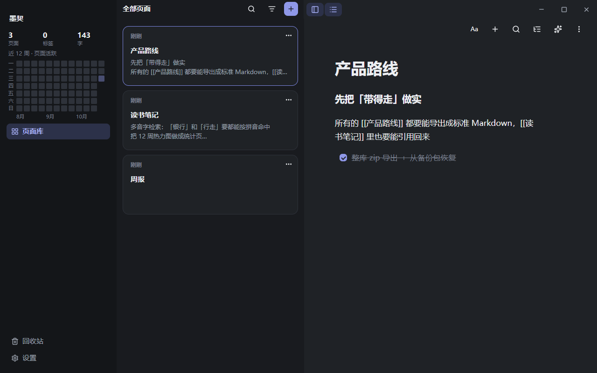
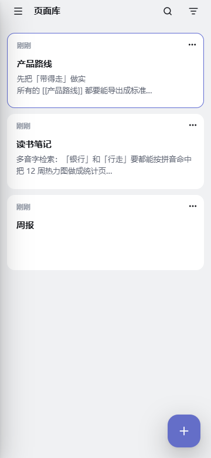
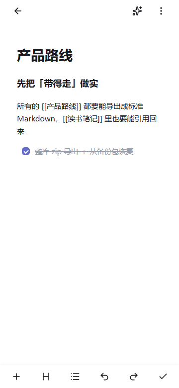

# 墨契 Moqi（项目代号 Project B）

**要双链、又要手机上能用——现在没人同时给你。**

墨契是一个**本地优先**的大纲双链笔记：所有内容都是块，页面之间 `[[双链]]` 相连，检索支持中文与拼音，数据是单文件 SQLite 随身带走。无账号、无遥测、无服务器。

- **桌面**（Windows）与 **Android** 一套交互两种形态
- **编辑器内核**独立成包（`@moqi/editor`），宿主契约 + 触控交互层全在包内
- 许可证：应用 **AGPL-3.0-or-later** · 编辑器包 **MPL-2.0**（闭源应用也能以依赖方式使用）· 文档 CC BY-SA 4.0

## 当前状态

**维护模式起步的开源首版（v0.6.1）**：桌面 + Android 的核心闭环（记下来 / 连起来 / 找回来 / 带得走）已可用并经过 214 项自动化验收；同步反馈面、部分导入保真等已知缺口见下方「已知限制」与 [ROADMAP](docs/ROADMAP.md)。

## 界面速览

<table>
  <tr>
    <td></td>
    <td></td>
  </tr>
  <tr>
    <td></td>
    <td></td>
  </tr>
</table>

## 下载

安装包与 Android APK 在 [GitHub Releases](https://github.com/phonedu/Moqi-notes/releases)（随发布挂出）；也可以从源码构建：

## 从源码构建

```bash
# Node 22+ / pnpm 9 / Rust stable
pnpm install
pnpm -C app dev              # 浏览器预览（最快看到界面）
pnpm -C app check            # 全部门禁
pnpm -C app tauri dev        # Windows 桌面窗口
pnpm -C app tauri android build --debug -t aarch64 --apk   # Android（需 SDK/NDK）
```

## 数据在哪

本地 SQLite 单文件 + assets 目录，见 [docs/DATA](docs/DATA.md)。导出为标准 Markdown 与整库 zip，**随时带走**。

## 从其他工具迁来

支持 Obsidian / 幕布 / 通用 Markdown 导入，逐项保真边界见 [docs/MIGRATION](docs/MIGRATION.md)。

## 已知限制（诚实清单）

- **同步**：块级合并可靠，但合并结果目前不弹提示；被覆盖版本仅当次会话可撤销
- **导入保真**：表格逐行降级、公式落文本、代码块语言不保留（见 [docs/MIGRATION](docs/MIGRATION.md) 边界表）
- **换机器**：整库 zip 会带走设备身份，导入前必读 [docs/DATA](docs/DATA.md)
- **AI 提示词质量**：未做自动化评测（链路已验），按真实使用迭代
- Windows 构建未签名（SmartScreen 会提示，见 [docs/SECURITY](docs/SECURITY.md)）

## 文档

[功能与概念](docs/FEATURES.md) · [上手指南](docs/USER-GUIDE.md) · [数据与备份](docs/DATA.md) · [迁移](docs/MIGRATION.md) · [架构](docs/ARCHITECTURE.md) · [路线图](docs/ROADMAP.md) · [FAQ](docs/FAQ.md) · [安全](docs/SECURITY.md) · [贡献](CONTRIBUTING.md) · [更新日志](CHANGELOG.md)

## 维护模式

**修 bug 与安全问题；功能冻结；不承诺路线图。** PR 欢迎但可能被拒——先开 Issue 讨论。功能请求请先读 [ROADMAP](docs/ROADMAP.md) 的「不做」清单。

## 许可

应用 [AGPL-3.0-or-later](app/LICENSE) · 编辑器包 [MPL-2.0](packages/editor/LICENSE) · 文档与设计资产 [CC BY-SA 4.0](LICENSE-DOCS) · 「墨契 / Moqi」名称与 Logo 见 [TRADEMARK](TRADEMARK.md)
